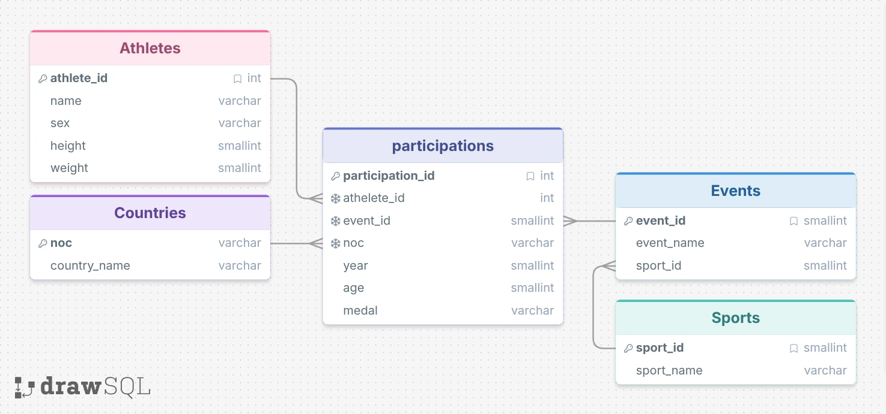

# Olympic Games Analysis (Python · SQL · Power BI)

Case study for a fictional sports analytics company, *SportsStats*, which works with news agencies and elite personal trainers.
Based on historical Olympic data (1904–2016, about 216,000 participation records, 228 NOCs, 49 sports), I answered two questions:

1. **Country success:** Which countries gained or lost the most medals in recent years? *(audience: news agencies)*
2. **Body and success:** Does height or weight relate to winning medals in specific sports? *(audience: elite trainers)*

## Workflow

| Step | Tool | What I did |
|---|---|---|
| 1. Normalization | Python (Pandas) | Split one flat CSV into 5 normalized tables, created IDs, checked uniqueness, missing values and referential integrity |
| 2. Database | PostgreSQL | Created tables with primary and foreign keys and an ENUM for medals, imported the CSVs, validated row counts and joins |
| 3. Analysis | SQL | Answered both questions with joins, aggregations, `CASE WHEN` and window functions (`LAG`) |
| 4. Visualization | Power BI | Built report visuals for both audiences |

## Data Model



`participations` is the fact table. `athletes`, `countries`, `events` and `sports` are dimension tables.

## SQL Highlights

Medal change compared with the previous Games, using a window function:

```sql
SELECT country_name, year, medal_count,
       medal_count - LAG(medal_count) OVER (PARTITION BY country_name ORDER BY year) AS change_vs_prev
FROM (
    SELECT c.country_name, p.year, COUNT(*) AS medal_count
    FROM participations p
    JOIN countries c ON p.noc = c.noc
    WHERE p.medal IS NOT NULL
    GROUP BY c.country_name, p.year
) t
ORDER BY country_name, year;
```

Medal rate by height group for each sport:

```sql
SELECT s.sport_name,
       CASE WHEN a.height < 1650 THEN '<165cm'
            WHEN a.height BETWEEN 1650 AND 1800 THEN '165-180cm'
            WHEN a.height BETWEEN 1801 AND 1950 THEN '181-195cm'
            ELSE '>195cm' END AS height_group,
       COUNT(*) AS total_participations,
       ROUND(100.0 * SUM(CASE WHEN p.medal IS NOT NULL THEN 1 ELSE 0 END) / COUNT(*), 2) AS medal_rate_pct
FROM participations p
JOIN athletes a ON p.athlete_id = a.athlete_id
JOIN events e   ON p.event_id   = e.event_id
JOIN sports s   ON e.sport_id   = s.sport_id
WHERE a.height IS NOT NULL
GROUP BY s.sport_name, height_group;
```

## Key Insights

**Country success**
- The USA, Russia (including the Soviet Union and the Unified Team) and Germany lead the all-time ranking.
- Comparing 1996–2004 with 2008–2016, the UK, China and France show the largest increase in medals.
- Medals have been spread across more countries in recent decades. 2016 had the widest participation (206 nations).

**Body and success**
- The effect of height depends on the sport. There is no general rule.
- **Swimming:** The medal rate rises from about 9 % in the smallest height group to about 18 % in the tallest.
- **Basketball:** Players over 199 cm have a medal rate of 32 %, compared with about 24.5 % in the smaller groups.
- **Gymnastics:** The opposite effect. Athletes under 158 cm win medals more often (7.2 %) than athletes over 169 cm (4.6 %).
- **Weightlifting:** No clear height trend. Weight classes are likely the deciding factor.

The full report (in German) is in [`docs/ergebnisbericht.pdf`](docs/ergebnisbericht.pdf).

## Repository Structure

```
├── python/olympia_normalize.ipynb            # normalization and data checks
├── sql/01_create_tables_and_import.sql        # schema and CSV import (PostgreSQL)
├── sql/02_validation.sql                      # row counts and join checks
├── sql/03_question1_country_success.sql       # question 1
├── sql/04_question2_body_and_success.sql      # question 2
├── powerbi/olympics_report.pbix               # Power BI report
├── data/                                      # small dimension tables (countries, sports, events)
└── docs/                                      # ERD and results report
```

The large tables (`olympics.csv`, `athletes.csv`, `participations.csv`, about 20 MB each) are not included.
The `COPY` paths in `01_create_tables_and_import.sql` point to a local PostgreSQL import folder and need to be adjusted.

Note: Height and weight are stored ×10 in the source data (1800 = 180 cm). The queries divide by 10 for output.

---

**Annika Heyer** · [LinkedIn](https://www.linkedin.com/in/annika-heyer-bb75b8419) · [GitHub](https://github.com/anni7heyer-dot)
